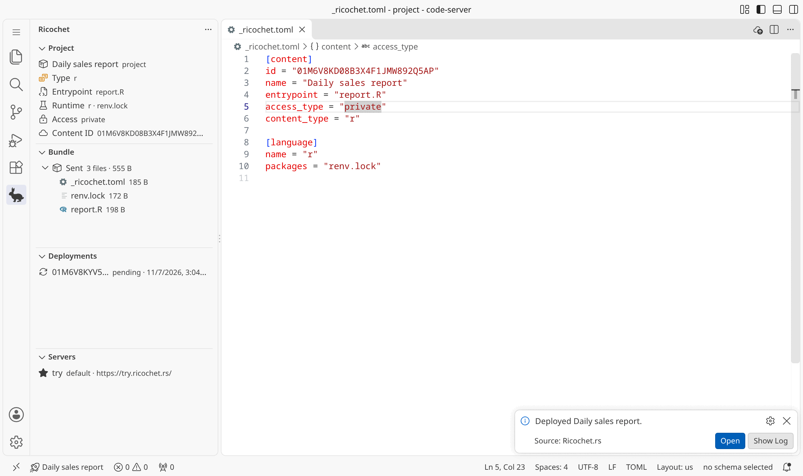

<p align="center">
  
</p>

<h1 align="center">ricochet for VS Code and Positron</h1>

<p align="center">
  Deploy your Shiny apps, APIs, reports, and scripts to ricochet from your editor.
</p>

<p align="center">
  <a href="https://docs.ricochet.rs/latest/user/deployment/1a-vs-code-and-positron/">Docs</a>
  ·
  <a href="https://ricochet.rs">Website</a>
  ·
  <a href="https://marketplace.visualstudio.com/items?itemName=ricochet.ricochet-rs">VS Code Marketplace</a>
  ·
  <a href="https://open-vsx.org/extension/ricochet/ricochet-rs">Open VSX</a>
</p>

---

[ricochet](https://ricochet.rs) hosts R, Python, and Julia apps and scripts on your own server or on ricochet Cloud.



## Install

1. Search for **ricochet.rs** in the Extensions view and select **Install**.

2. Install the ricochet CLI, version 1.4.0 or newer.

   ```sh
   curl -fsSL https://raw.githubusercontent.com/ricochet-rs/cli/main/install.sh | sh
   ```

   On Windows, follow the [CLI install guide](https://docs.ricochet.rs/latest/user/deployment/1-ricochet-cli/#installation).

3. Select the rabbit in the activity bar, then select **Add Server** in the **Servers** view and enter your server's URL.
   If you don't have a server, sign up at [try.ricochet.rs](https://try.ricochet.rs), a trial server that ricochet wipes every week.

4. Select **Login** and paste an API key.
   Use the button in the login prompt to open your server in the browser and create a key there.

## What you can do

- Deploy from the **Project** view and track each deployment in the **Deployments** view.
- Create `_ricochet.toml`, your project's settings file, by choosing your app's main file from a list.
- Catch mistakes in `_ricochet.toml` as you type, and autocomplete any setting.
- Check which files you'll upload in the **Bundle** view before you deploy.
- Run a deployed script or report on demand with **Run Task Now**, then read its output.

## Development

```sh
bun install
bun run test
# On a Linux machine without a display, run this under xvfb-run -a
bun run test:host
```

Press <kbd>F5</kbd> in VS Code to try your changes in a new window.

## License

[MIT](LICENSE)
